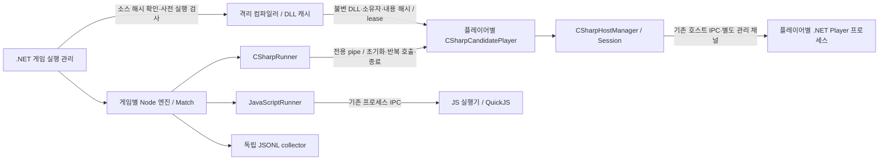

# C# C4-D Node 게임 엔진·실행기 후보 연결

작성: 2026-11-19. [계정 검사 연결](csharp-account-validation-c4c.md)에 이어 Node 공통 runner와 실제 C# Player 프로세스를 연결했다. **혼합 게임의 준비·호출·종료를 검증하는 개발 후보 경로이며, 공개 C# 지원이나 다국어 전체 완료가 아니다.** 공개 저장/게임·기본 registry는 계속 JavaScript만 허용한다.

후속 [리뷰 수정](csharp-c4cd-review-fixes-2026-11-19.md): C#은 Node의 OS 자식 프로세스가 아니지만 이제 **게임 전체 부모 자원 scope에는 포함된다.** 게임 예약/회계가 Node와 C# 모두를 포함하고 private 파일 삭제 실패는 별도의 정리 대기·재시도로 처리한다. 아래 최초 C4-D 수명 설명/시간 표본은 수정 전 기록과 함께 읽는다.

## 구조



게임 규칙·아이템·이동·점수·독립 턴과 화면용 snapshot 생성은 기존 Node `Match`가 담당한다. C# 중계 모듈은 알고리즘 실행만 담당하는 추상 실행기의 뒷부분이다. `CSharpCandidatePlayer`는 기존 .NET 실행 관리 프로세스 안의 객체/비동기 작업이며 별도의 서버 프로세스를 추가한 것이 아니다.

게임 준비 시 C# 참가자마다 원문·검사 프로필을 검증하고 [C4-C](csharp-account-validation-c4c.md)의 36회 사전 검사를 수행한다. 통과한 DLL의 lease를 게임에 고정한다. 같은 소스/toolchain이면 DLL 바이트는 공유할 수 있지만 Player 프로세스·객체·필드는 플레이어/게임마다 독립적이다.

Node 초기화는 `RunnerRegistry → CSharpRunner.initialize`를 호출하고, .NET 부모가 준비된 DLL로 생성한 실제 Player 객체를 유지한다. 이후 `move`는 기존 `CSharpHostSession.MoveNextAsync`를 호출하며 컴파일·원문 읽기·운영 HTTP/DB 요청을 하지 않는다. Node 기본 게임·JS runner 동작은 유지한다.

## 통신·세션 바인딩

플레이어별 별도 named pipe를 사용한다. 채널 한 개의 계산이 다른 플레이어의 요청 큐를 막지 않는다. 별도 reader가 close를 받아 계산/초기화 취소와 실제 정리를 진행하므로 장시간 호출 뒤에 종료 요청을 단순히 줄 세우지 않는다.

- 프레임: 4바이트 little-endian 길이 + UTF-8 JSON. 요청 최대 1 MiB, Node 응답 최대 64 KiB.
- 명령: 버전·요청 UUID·initialize/move/close, gameId/playerId/runId/artifactId와 임시 인증 토큰, 입력 데이터.
- .NET에서 게임/플레이어/산출물/토큰과 요청 중복·중첩·호출 순서를 검사한다. Node에서도 공통 lifecycle·결과 identity·call ID를 검사한다.
- .NET 호스트의 실제 내부 호출 번호에는 생성/초기화/이름 호출이 포함된다. 중계는 이를 Node의 1부터 시작하는 move call ID에 대응시키고 같은 host generation/instance를 유지한다.
- pipe는 같은 OS 사용자로 제한한다. 엔진에 전달하는 endpoint/token은 게임별 `csharp-runners.private.json`에 보관하며 JS 알고리즘 자식 환경에 전달하지 않는다. DLL의 내부 경로도 알고리즘 입력에 넣지 않는다.
- 공통 로그에는 공개 artifact metadata·runner identity·호출 결과만 사용한다. endpoint/token은 기록하지 않고 실제 정리 후 private 파일을 삭제한다. 재시작 복구도 이전 private 파일을 제거한다.

런타임/호스트/참조 버전은 기존 manifest fingerprint와 lease 검사로 확인한다. 이 검사는 임의 DLL 업로드의 인증 서명이나 OS 전체 권한 격리를 대체하지 않는다.

## 시간과 실패

`executionMs`는 기존 C# guard가 기록한 실제 호출 구간이며 경계 이름은 `dotnet-guarded-call-v1`이다. Node의 JSON/pipe·중계·호스트 왕복은 별도 `roundTripMs`에 포함한다. 중계가 전달받았다는 이유로 500ms를 시작하거나 실행 종료를 판정하지 않는다.

- 500ms timeout은 실제 settled 확인 후 제자리 결과를 반환한다. 그 호출 이전에 변경한 일반 필드는 유지하며 같은 인스턴스에서 다음 호출을 수행한다.
- 잘못된 방향 반환은 `invalid-result/-1`로 해당 턴만 처리하고 다음 호출을 허용한다.
- 현재 C# 후보 프로필의 실행 예외·operation-limit은 재사용 불가능한 호스트 실패로 처리한다. timeout으로 위장하거나 자동 재시작하지 않는다. 원래 판정은 해당 턴의 `runtime-failure` 이벤트의 `status`에도 남긴다.
- 랜덤점프는 기존 엔진 경로대로 알고리즘 호출 없이 수행한다. 액션 속도나 다음 턴 시작에 공통 시간 장벽·고정 보정을 추가하지 않았다.
- C# 디버그 출력 API는 이번에 추가하지 않았다. 현재 제한 프로필의 공통 결과 `logs`는 빈 배열이다. 정식 언어 규약·debug 기능은 후속 범위다.

**호출 비용의 언어 간 동일성은 아직 달성하지 않았다.** 기존 JS는 Node→JS 실행기 1회 IPC이고 현재 C# 후보는 Node→.NET 중계→C# 호스트의 2회 IPC다. 500ms 예산에서는 중계 비용을 제외하지만 실제 게임에서는 응답 지연이 턴 진행에 영향을 줄 수 있다. 이는 고정 시간 보정으로 숨기지 않는다. 중계 단계를 줄이거나 언어별 공통 호출 경로를 마련하고, 동일 입력/알고리즘·위치 교환·동시 부하에서 비용을 비교한 뒤 정식 채택해야 한다. 이번 보고서의 소규모 혼합 게임 시간 표본은 용량/공정성 보장값이 아니다.

이번 6×6 혼합 게임의 정상 반환에서 `roundTripMs - executionMs`를 집계하면 C# 10개 표본의 p50 약 1.60ms/p95 약 14.25ms, JS 14개 표본의 p50 약 0.51ms/p95 약 0.88ms다. 초기 호출을 포함하며 C#은 필드 증가/방향 반환, JS는 제자리 반환이라 동일 알고리즘 비교가 아니다. 이 값으로 언어 자체의 속도 차이나 중계 한 단계의 비용을 단독 추정하지 않는다. 정식 비교에 사용할 측정 경계가 실제 게임 로그에 연결됐다는 의미다.

## 실제 종료

C# 호스트는 Node의 자식 트리 밖에 있으며 .NET 부모가 소유한다. 따라서 Node 그룹을 종료했다고 C# 자원이 정리됐다고 처리하지 않는다.

1. 정상 종료는 Node가 runner close receipt를 기다리고, .NET 중계가 실제 호스트 정리를 확인한 뒤 응답한다.
2. 엔진 단절/강제 종료 시 pipe EOF가 C# 호출을 취소하고 실제 세션을 정리한다. 부모의 게임 finally도 모든 C# 중계를 명시적으로 회수한다.
3. Node 그룹 정리에 실패해도 C# 정리는 별도로 시도한다. 확인 실패가 하나라도 있으면 cleanup-unconfirmed와 예약/lease를 유지한다.
4. DLL pin과 임시 인증 파일은 확인된 종료 후에만 반환/삭제한다. 후보 검사 hosted service는 새 검사를 중단하되, cache dispose는 모든 hosted service가 멈춘 뒤로 늦춰 진행 게임의 lease를 보호한다.
5. runner 채널 실패로 clean close를 증명하지 못하면 엔진의 `cleanup-failed`를 부모에 전달한다. 부모는 failed 통보 즉시 그룹 정리로 진행하고 JSONL의 내구 prefix를 복구한다. 실제 종료 대신 stop 요청만으로 complete receipt를 만들지 않는다.

Windows 실제 시험으로 정상/계산 중 정지·Node crash·활성 게임을 가진 서비스 종료를 확인했다. Linux 강제 제한·권한·부모 서비스 crash/restart의 혼합 언어 검증과 최종 운영 복구 정책은 남아 있다.

## 개발 후보 경로

다음 설정이 모두 있는 신뢰된 실행 서비스만 허용한다. 실제 사용자 설정/서버에는 적용하지 않았다.

```text
Backend__CSharpValidation__Enabled=true
Backend__CSharpValidation__HostAssembly=<절대 경로>/CoinHunter.CSharp.Host.dll
Backend__CSharpGameCandidate__Enabled=true
```

내부 Bearer 인증을 사용하는 `POST /internal/v1/candidates/matches`에서 user scope와 적어도 한 명의 C# 참가자가 있는 `ExecutionRequest`를 받는다. 게임 준비 전체의 후보 기한은 120초다. 이후 기존 내부 start/state/stop/recording 경로를 사용한다. 저장된 계정 데이터의 C# 게임 허가 플래그는 여전히 false이며 이 개발 경로가 공개 실행 허가를 부여하지 않는다.

기존 C# 호스트와 중계의 요청 수명 한도 10,000개도 유지한다. 장시간 경기의 한도/보유 정책을 확정한 것이 아니며 프로세스 자동 교체로 우회하지 않는다.

일반 `/internal/v1/matches`, 공개 운영 API, `ContractValidation.Execution` 기본값과 `createJavaScriptRegistry`는 C#을 거절한다. 게스트 C#도 허용하지 않는다. FE 언어 선택과 본인 이전 C# 경기 기록을 이용한 공개 재대결은 아직 구현하지 않았다.

## 검증과 재현

신규 .NET 혼합 게임 확인 30개와 Node 실행기/수명 관련 52개 검사를 수행했다. [최종 혼합 게임 원본](benchmarks/csharp-c4d-2026-11-19.json).

- 같은 DLL을 사용하는 C# 2명 + JS 1명, 별도 C# 게임의 독립 객체/진행.
- 실제 게임에서 4번째 C# 호출 timeout → 같은 instance/필드의 5번째 정상 호출, timeout 전에 빠른 JS가 독립적으로 여러 턴 진행.
- 준비 후 C# 원문 사본 삭제 상태에서 게임 진행, 게임 중 DLL 미변경, 같은 코드의 DLL 1개 공유.
- 잘못된 방향의 현재 턴 처리, 다음 호출, 후속 실제 예외와 턴 실패 진단·partial JSONL.
- 활성 계산 정지, Node 프로세스 강제 종료, 활성 게임을 가진 hosted service 종료, 예약/호스트 0.
- 기본 계약/registry·비활성 후보 설정·게스트의 C# 거절, artifact/source/run/host 바인딩과 분할 프레임, clean close 위조 방지.
- 임시 endpoint/token이 JSONL에 없으며 종료 뒤 private 파일 삭제.

기존 백엔드 전체 회귀는 통과했다. Node 전체 직렬 실행은 296건 중 295건 통과했고, 이전부터 재현되던 `test/account-file-lock.test.js`의 레거시 다중 프로세스 owner 파일 생성 `EPERM` 1건이 다시 발생했다. 해당 파일만 분리 재실행한 9건은 통과했다. 전체 Node 통과로 간주하지 않으며 이 레거시 파일 잠금 문제는 이번 .NET 운영 저장소/게임 연결 변경과 별도로 남는다.

백엔드 전체 실행 시점의 C4-D는 29건이었으며, 최종 실패 상태의 턴 기록 검사·시간 표본 보강 후 C4-D 30건과 Node 관련 52건을 별도로 재검증했다. 최종 빌드 경고·오류는 0개다.

```powershell
$env:COINHUNTER_BUILD_ROOT='artifacts/c4d-build'
node scripts/backend.js test
# 빌드 후 혼합 게임만:
dotnet artifacts/c4d-build/bin/CoinHunter.Backend.Checks/debug/CoinHunter.Backend.Checks.dll . csharp-games
node --test test/csharp-runner.test.js test/runner-contract.test.js test/javascript-runner.test.js test/match-lifecycle.test.js
```

## 남은 순서

1. Node/.NET/C# IPC 단계·직렬화/복사·실제 호출·엔진 적용 시간을 비교하고 비대칭 중계를 개선한다. 고정 대기/보정으로 승부를 맞추지 않는다.
2. native/GC/긴 builtin의 실제 중단·객체 유효성, C# debug/오류·자원 초과 규약, watchdog/grace/반복 실패 정책을 확정한다.
3. Linux 자원/권한·부모 장애 감독, 혼합 언어 동시 부하·로그/정리·캐시 볼륨·보유 정책을 검증한다.
4. 정식 채택 관문 통과 시 운영 API/계정 경기·이전 기록의 source/artifact snapshot과 언어 capability를 통일하고 FE 언어 선택을 별도 연결한다. Python/C++는 각 후속 계획대로 진행한다.

C4-C와 이번 C4-D는 아직 커밋하지 않았다. 사용자 서버·실제 데이터는 변경하지 않았다.
