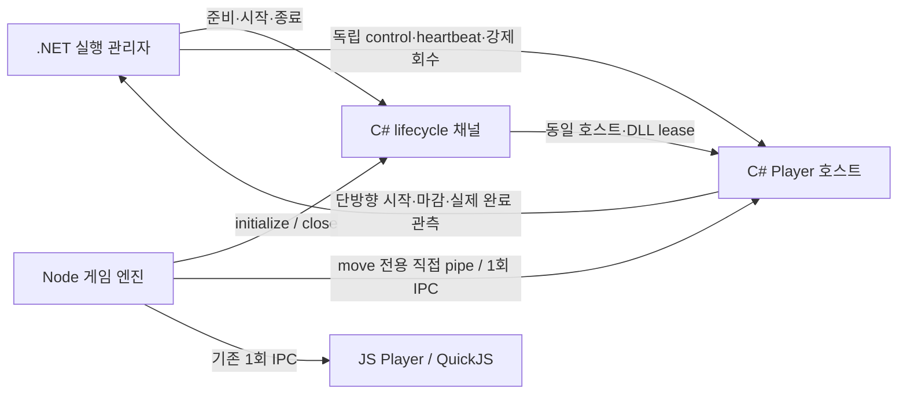

# C# 호출 비용 개선·정식 지원 준비

후속: [2026-11-20 GC 구간 후보·실제 DLL 호스트 검증](csharp-gc-window-candidate-2026-11-20.md). 누적 할당 감시·GC 시험을 추가했으나 기본 정책은 바꾸지 않았으며 공개 C#은 계속 비활성이다.

- 작성: 2026-11-19. 기준: `f28097e` 이후 작업 트리.
- 요청 1번: 직접 턴 호출과 동일 전략 비교를 구현·측정했다. 운영 환경에서의 지연/처리량 보장은 별도다.
- 요청 2번: Windows에서 구현·검증 가능한 실행/진단/운영 기반과 Linux 인수 검사 코드를 준비했다. **실제 Linux 검증과 OS 파일/네트워크 격리, 공개 운영 API·기록·UI 연결은 미완료**다. 현재 PC의 WSL은 설치되지 않아 Linux를 실행할 수 없었다.
- 공개 언어는 JavaScript 하나이며 C#은 내부 opt-in 후보다. 이 문서의 준비 완료 항목이 정식 지원 활성화를 뜻하지 않는다.

## 1. 호출 경로와 계산 시간



기존 Node→.NET 중계→C# Player의 턴별 중계를 제거했다. .NET 관리자는 OS 자원 범위·준비/산출물 lease·독립 감시·실제 종료를 계속 소유한다. Node의 게임 규칙과 플레이어별 독립 턴은 유지한다. 컴파일/원문 읽기/운영 HTTP·DB 접근은 턴 호출에 들어가지 않는다.

호스트의 실제 실행 완료 후 응답을 인코딩·전송하며 불필요한 thread-pool 재배치를 줄였다. 이 처리는 사용자 예산과 상태 lock 밖에서 실행된다. 감시 채널이 지연되어도 사용자 결과를 반환하려고 .NET 중계의 응답을 기다리지 않는다. 감시 실패 시에는 해당 게임을 인프라 장애로 종료하고 실제 자원을 회수한다.

JavaScript는 기존 `quickjs-call-v1`에 포함되던 guest JSON 해석을 별도로 수행하도록 바꿨다. 입력 해석용 원본 intrinsic을 사용자 코드 로드 전에 보관하여 `JSON.parse` 변경으로 우회하지 못하게 한다. 현재 경계는 `quickjs-call-v2`, JS adapter/options fingerprint는 v2다. 입력 준비 실패는 Player를 호출한 timeout으로 표시하지 않는다.

C# 경계는 `dotnet-guarded-call-v1`이며 map/items 복사·JSON 해석은 계산 구간 밖이다. 준비된 delegate를 인스턴스마다 한 번 바인딩해 반복 reflection 탐색/인자 배열 생성을 제거했다. 두 경계 모두 신뢰된 dispatch/guard의 작은 비용을 포함하며 순수 CPU 명령만을 측정한 값은 아니다.

- `executionMs`: 런타임 호출 경계의 실제 경과 시간. 각 턴 예산은 500ms.
- `roundTripMs`: 엔진 실행기 어댑터에서 본 실제 왕복.
- `inputPreparationMs`: 입력 변환·해석/복사. C#은 Node 인코딩과 호스트 준비를 합산한다. JS는 host stringify·guest decode를 포함하며 Node IPC 인코딩 전체를 계측한 값은 아니다.
- C# `responseProcessingMs`: Node의 응답 JSON 해석/검사 일부. 전체 응답 처리 비용이나 서버 인코딩 시간을 뜻하지 않는다.
- `roundTripMs - executionMs`: 준비·직렬화·프로토콜 검사·OS 스케줄링 등을 포함한 잔여 비용이다. 순수 IPC 비용과 같다고 해석하지 않는다.

계산 완료 즉시 액션·액션 완료 즉시 다음 계산을 유지한다. 공통 대기 시간이나 속도 보정은 도입하지 않았다.

## 2. 동일 입력 비교와 한계

[측정 집계·첫 호출/느린 표본](benchmarks/csharp-invocation-2026-11-19.json)에 변경 전 `8b626ba`와 변경 후를 보관한다. 변경 전 저장소를 `artifacts`에 격리 추출하고 동일 측정 하네스만 추가해 빌드했다. 실제 사용자 서버/코드/계정 데이터는 사용하지 않았다.

- 같은 배열 기반 BFS·탐색 순서·상태 재사용, 동일 map/position/items 시퀀스.
- 6×6, 20×16, 40×30, 버전마다 총 3,600회. 첫 호출 포함, 실패 재시도 없이 모든 방향/상태 검사.
- 직렬 호출과 네 실행기의 독립 동시 스트림. 측정 하네스의 배치가 게임 진행에 공통 턴 장벽을 추가하지 않는다.
- 실제 엔진에서도 C#/JS 각각 2명을 같은 대칭 맵에 배치하고 시작 모서리의 언어 배정을 서로 교환한 두 게임을 완료했다. 계산이 빠른 쪽의 이점을 없애거나 점수 동률을 요구하지 않는다.

호출 단계가 같아졌어도 언어별 직렬화/스케줄링 비용은 같지 않다. 모든 조건의 성능 개선을 보장하지 않으며 큰 맵 동시 부하의 지연 증가 표본도 집계에 남겼다. 런타임/guard/delegate와 JS 측정 경계도 함께 바뀌었으므로 수치 차이를 IPC 한 단계 제거의 효과로만 해석하지 않는다. 운영 CPU 할당과 동시 게임 수에서 재측정해야 한다.

최종 코드의 C# 왕복 p95 표본(ms). 변경 전/후 각 1회 측정이며 신뢰 구간을 산출한 값은 아니다.

| 맵    | 호출 조건 | 변경 전 | 변경 후 |
| ----- | --------- | ------: | ------: |
| 6×6   | 직렬      |   0.605 |   0.422 |
| 6×6   | 동시      |   1.152 |   0.786 |
| 20×16 | 직렬      |   0.748 |   0.646 |
| 20×16 | 동시      |   1.108 |   0.939 |
| 40×30 | 직렬      |   1.389 |   1.117 |
| 40×30 | 동시      |   1.598 |   1.806 |

## 3. C# 프로필 v3와 진단

[기계 판독 프로필](../backend/contracts/csharp-bounded-profile-v3.json): `csharp-restricted-c1-v3` / analyzer `c1-4` / guard `c2-poll-bounded-v3` / adapter `csharp-direct-pipe-v2`. 기존 산출물은 toolchain/reference fingerprint가 달라 새 검사·컴파일을 거친다.

```csharp
Debug.Print("코인 발견");
Debug.Print(position);
```

호스트 SDK의 스칼라 출력만 허용한다. 사용자에게 host assembly 참조를 허용하지 않고 실제 심볼이 SDK인 호출을 검사·변환한다. 호출당 30줄·줄당 1,024 UTF-16 단위와 초과 개수를 적용하며 정상/timeout 결과에 로그를 전달한다. surrogate pair 중간에서 자르지 않는다. 한국어 최대 출력도 처리하도록 응답/부모 관측 프레임을 256KiB로 제한한다. 요청 프레임은 1MiB다.

문자열 연결은 할당 전에 최대 65,536자를 검사하고 전후 guard를 수행한다. 과대 상수도 검사한다. 문자열 `+=`는 현재 프로필에서 거부하며 `s = s + value`를 사용한다. 비스칼라와의 암묵적 연결도 거부한다. 이는 코드 파일 크기 제한과 별개다.

배열/컬렉션 한도를 계승하며 초과는 `operation-limit/string-characters` 등으로 구분한다. 사용자 예외는 안전한 타입/한도 코드와 마지막 원본 guard 위치를 `runtime-failure.diagnostic`에 기록한다. guard 위치는 정확한 예외 발생 표현식의 stack trace를 뜻하지 않는다. 서버 경로/stack/source 원문은 보내지 않는다.

실제 완료된 timeout은 같은 PID·객체·기존 필드로 재호출한다. 예외/operation-limit이나 감시 실패는 현재 후보의 재사용 불가능한 장애이며 timeout으로 위장하거나 자동 재시작하지 않는다. 실패를 Node에 전달한 뒤 호스트를 종료하여 실제 오류 대신 단순 EOF만 남는 경합을 막았다. 호스트 회수가 확인되면 실패 게임도 완결 JSONL/receipt를 만들 수 있으며 결과 outcome은 계속 failed다.

직접 게임 채널은 단조 증가 call ID로 전체 수명의 재전송을 차단하고 UUID 이력은 256개만 보관한다. 10,000회에 프로세스를 교체하는 제한을 제거했다. 10,005회 실제 호출 후 같은 인스턴스 유지와 오래된 call ID 거절을 검사한다. 준비/검사에 쓰이는 기존 stdin 호스트 프로토콜과 수명을 구분한다.

## 4. 운영 설정·캐시·상태

다음 설정은 `Backend:CSharpRuntime:*` 또는 대응 환경변수로 조절한다. 사용자 계산 예산 500ms는 바뀌지 않는다.

| 설정                                      |      기본값 | 의미                                           |
| ----------------------------------------- | ----------: | ---------------------------------------------- |
| PreparationMs                             |       15000 | 준비/활성화 기한                               |
| StartNotificationMs                       |        1000 | 실제 실행 시작 관측 기한                       |
| UnsettledExecutionMs                      |        2000 | 시작 후 실제 완료 관측 기한. 500ms 초과여야 함 |
| HeartbeatIntervalMs / HeartbeatResponseMs |  100 / 1000 | 독립 관리 채널 상태 확인                       |
| StopGraceMs / CleanupMs                   | 1000 / 5000 | 협조 종료 유예 / 실제 자원 회수 기한           |
| MinimumFreeDiskMiB                        |         256 | 준비 전·원문 사본 작성 중 디스크 여유 보호     |
| ArtifactRetentionDays                     |           7 | 캐시 정리의 최근 접근 보유 기간                |

이 값은 초기 로컬 운영 정책이며 Linux/실배포의 지연 상한을 검증한 값은 아니다. 정상 500ms timeout 횟수만으로 프로세스를 종료하지 않는다. 미종료/관리 채널 장애는 해당 게임을 실패 처리하며, 실제 자원 회수가 확인되지 않으면 예약/lease를 유지하고 새 C# 호스트 시작을 차단한다. 코드 수정 없이 동일 인스턴스를 자동 재시작해 상태를 초기화하지 않는다.

내부 Bearer 인증 경로:

- `GET /internal/v1/candidates/csharp/readiness`: 실제 후보 설정·정책·미통과 관문·활성/강제 종료 통계. 최근 종료 32건은 host ID와 정리 사유만 가지며 재시작 시 초기화되는 진단이다. durable 운영 모니터링을 대체하지 않는다.
- `POST /internal/v1/candidates/csharp/cache/maintenance`에 `{"dryRun":true}`로 제안 확인, `{"dryRun":false}`로 적용. 생략은 거부한다.

정리는 private objects의 오래된 파생 DLL/manifest만 대상으로 하며 현재 lease·최근 접근·알 수 없는 파일/redirected 경로를 보존한다. 자동 백그라운드 삭제 작업은 추가하지 않았다. 원문/계정 메타데이터를 삭제하지 않으며 파생 산출물은 원문에서 다시 만들 수 있다. 전체 계정 삭제와 원문/로그 보유 정책은 마지막 개인정보 운영 준비 범위다.

## 5. 검증과 남은 채택 관문

Windows에서 전체 BE 회귀, 실제 혼합 게임/위치 교환, API 인증/설정·캐시 dry-run/lease, 직접 채널의 잘못된 토큰·실행 미종료·시작 관측 누락·한국어 대량 출력·장시간 호출을 검사한다. JS 전체 회귀도 실행한다. 실제 숫자와 최종 판정은 [검증 집계](benchmarks/csharp-readiness-2026-11-19.json)에 보관한다.

문자열/배열·128MiB 잔류 메모리 조건의 기본 연산 측정은 별도 OS 제한 프로세스에서 수행한다. 일부 측정 시 BE 회귀가 병행된 부하 조건이며 단일 연산의 통계적 상한이 아니다. bounded native 복사·할당·GC를 정확히 500ms 시점에 강제 선점할 수 있다는 증명은 하지 않는다.

최종 전체 BE는 계약 35·업무 19, C# 분석 66·정책 7·예산 233·호스트 30·부모 42·준비 37·preflight 53·계정 44·게임 39, 직접 채널 10,022개 assertion(10,005회 수명 검사 포함), 이전 리뷰 수정 20·OS 7과 통합 13그룹·프로토콜 5건을 통과했다. 빌드 경고/오류 0개, Node 297건 통과다.

메모리 압박 fixture의 499ms 부근에서 시작한 반복 할당은 약 **507.20ms**에 실제 완료/timeout으로 판정됐다. 문자열 연결 단독 최대는 약 0.285ms, 128MiB 잔류 메모리 조건 반복 할당의 단독 최대는 약 37.43ms였다. 실제 Player의 모든 입력에 대한 선점 상한으로 사용할 수 없으며 native/GC 채택 관문을 통과한 것으로 표시하지 않는다.

| 항목                                                       | 현재 판정                                                       |
| ---------------------------------------------------------- | --------------------------------------------------------------- |
| 직접 호출·동일 입력 비용 비교                              | Windows 구현/측정 완료. 운영 사양의 재측정 필요                 |
| debug·문자열 한도·runtime 진단·감시/캐시 정책              | 구현·Windows 회귀 완료                                          |
| Linux cgroup 계층·직접 IPC·혼합 게임 인수 코드             | 작성·Windows 컴파일 확인. Linux 실행 미검증                     |
| Linux 파일/네트워크 격리·비관리자 배치·외부 부모 장애 감독 | 실제 배포 환경에서 구성/검증 필요. cgroup은 보안 sandbox와 다름 |
| native/GC·혼합 게임 운영 부하/장애·보유 정책의 최종 승인   | 추가 실환경 근거 필요                                           |
| 공개 계정 C# 저장/경기·이전 경기 기록·언어 UI              | 위 채택 관문 이후 연결. 미구현/비활성                           |

재현(현재 PC는 Windows):

```powershell
$env:COINHUNTER_BUILD_ROOT='artifacts/csharp-readiness-build'
node scripts/backend.js test
node --test --test-concurrency=1 test
dotnet artifacts/csharp-readiness-build/bin/CoinHunter.Backend.Checks/debug/CoinHunter.Backend.Checks.dll . csharp-invocation
dotnet artifacts/csharp-readiness-build/bin/CoinHunter.Backend.Checks/debug/CoinHunter.Backend.Checks.dll . csharp-builtins
```

Linux에서는 .NET 10/Node·의존성 빌드와 cpu/memory/pids/cgroup.kill을 쓸 수 있는 위임된 cgroup v2 subtree가 필요하다. 테스트 프로세스에 기존 서비스의 cgroup 경로/관리자 권한을 임의로 부여하지 않는다.

```sh
export Backend__Resources__CgroupRoot='/sys/fs/cgroup/coinhunter-test'
export COINHUNTER_BUILD_ROOT=artifacts/csharp-linux-build
node scripts/backend.js build
dotnet artifacts/csharp-linux-build/bin/CoinHunter.Backend.Checks/debug/CoinHunter.Backend.Checks.dll . csharp-linux
```

이 묶음은 별도 테스트 scope에서 메모리/CPU/자손 회수·부모/자식 계층 제한, 직접 호스트와 위치 교환 게임을 확인한다. 통과하더라도 파일/네트워크 sandbox·외부 감독·운영 복구와 공개 제품 연결까지 완료한 것으로 취급하지 않는다. **2번 전체를 마감하려면 해당 실환경 검증과 공개 제품 연결이 남아 있다.**
