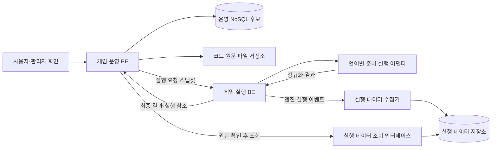

# 게임 운영·게임 실행 백엔드와 데이터 경계

- 결정일: 2026-11-15
- 기준: 사용자 정의에 따라 게임 엔진의 실행 영역을 제외한 서비스 관리 영역을 **게임 운영**이라고 부른다. 운영 데이터 관리와 실제 실행 데이터 수집은 별도 책임·저장 계약으로 구성한다.
- 상태: BE 1~9단계를 로컬 구현했다. 기본 경로는 Node 정적 중계 → C# 운영 → C# 실행 관리 → 경기별 Node 엔진이며 전량 JSONL 수집도 연결했다. 실제 사용자 이전·NoSQL·다국어·외부 배포는 별도다. [구현 결과/제한](backend-split-completion.md), [실행법](../backend/README.md).
- 우선 적용: 이전 문서의 일반적인 메타데이터/로그 구분보다 이 책임 경계를 우선한다. FE/BE 분리는 2026-11-15 배포 준비로 전환했으며 다국어 구현은 기존 보류를 유지한다. 실행 데이터 계약은 처음부터 언어 중립으로 설계한다.
- 최신 흐름: [게임별 엔진 분리와 화면 렌더링](game-execution-rendering-flow.md)에 C# 운영 BE·상주 실행 관리자·경기별 Node.js 프로세스·독립 수집·브라우저 보간의 전체 과정과 차트를 보관했다. 로컬 구현과 운영 배포 준비는 구분한다.
- 실제 작업 순서: [BE 분리 9단계 계획](backend-separation-implementation-plan.md)을 기준으로 계약·닷넷 운영·실행 관리·게임별 엔진과 연결을 먼저 구현한다. 호스트/컨테이너 배포와 DB 제품 전환은 별도다.
- 관련: [실행 로그 분석](game-log-storage-analysis.md), [로그 수집 모듈·추상화 계약](game-log-collection-modules.md), [운영 저장 어댑터](storage-adapters.md), [남은 작업](remaining-work.md).

## 1. 두 백엔드의 책임

| 영역         | 책임                                                                                             | 보관 데이터                                                                                                                   |
| ------------ | ------------------------------------------------------------------------------------------------ | ----------------------------------------------------------------------------------------------------------------------------- |
| 게임 운영 BE | 계정/OAuth·권한·알고리즘 보관/선택·맵/옵션·사용자/관리자 메뉴·대회/매칭·실행 요청·결과 조회/인가 | 계정·신원·역할·알고리즘 메타데이터·맵/옵션/게시·대회·경기 목록/요약·실행 참조. NoSQL이 적합할 수 있으며 제품/모델은 별도 선정 |
| 게임 실행 BE | 엔진 판정·진행 중 경기 상태·언어별 준비/실행기·실행 수명·전량 결과 수집                          | 실행 요청 스냅샷·초기화/빌드/실행 결과·모든 턴/액션/기믹·오류/종료/취소·실행 환경·완결 기록                                   |

실행 BE 내부에서 엔진과 데이터 수집기는 다시 모듈/프로세스 경계를 둔다. 엔진은 경기 판정과 이벤트 생성, 수집기는 이벤트 순서·내구 저장·완결·복구·읽기/보관을 담당한다. 신뢰된 언어별 실행 어댑터가 알고리즘 결과를 공통 형식으로 전달한다.

수집기는 공개 인터페이스로 주입하고 내부의 수집 정책·저널 저장 어댑터·실행 기록 목록·아카이브를 분리한다. 엔진이 파일/DB/SDK를 직접 호출하지 않으며 저장소 교체 시 이벤트와 확인 의미를 유지한다. 구체 책임·접수/내구 확인·장애/종료·교체 검증은 [로그 수집 모듈 계약](game-log-collection-modules.md)을 따른다.

여기서 게임 운영 데이터는 사용자/맵/알고리즘을 관리하는 서비스 데이터다. Pino 등의 HTTP/access/error 서버 운영 로그는 관측 자료이며 이 업무 데이터나 전량 경기 저널을 대신하지 않는다.



## 2. 게임 운영 저장소

운영 NoSQL은 다음 업무 문서를 관리하는 후보로 비교한다. MongoDB 등 특정 제품의 채택 확정은 아니다.

- 사용자·Google 신원 연결·역할·이용 상태.
- 알고리즘 소유자·이름·언어·리비전·원문 파일 참조.
- 맵/옵션·초안/게시 상태·표시 순서.
- 향후 대회/참가/제출·매칭·경기 실행 요청과 상태.
- 완료 경기의 사용자용 요약과 실행 ID·저장소 참조·기록 완결 상태.

코드 원문과 기존 경기 코드 사본은 파일을 유지한다. 운영 DB에 원문 전체를 넣는 요구로 바꾸지 않는다. 운영 API의 소유권·신원 유일성·저장 충돌·권한 변경 원자성 계약은 NoSQL 어댑터에서도 유지한다.

매 턴 이벤트를 운영 사용자 문서·알고리즘 문서·경기 목록 문서에 계속 붙이지 않는다. 운영 저장소의 제품 선택과 전량 실행 기록의 제품/형식은 각각의 조회·쓰기·내구 요구로 선정한다.

## 3. 게임 실행 데이터 수집

실행 데이터는 특정 Node 로거가 남기는 문자열에 종속시키지 않는다. 게임 엔진이나 실행기가 JavaScript/C#/C++/Python 등 어떤 언어로 구현되더라도 동일한 의미의 버전 있는 이벤트를 생산하고 수집할 수 있어야 한다. 현재 이 언어들이 구현되어 있다는 뜻은 아니다.

| 단계          | 수집 범위                                                                                                                                                   |
| ------------- | ----------------------------------------------------------------------------------------------------------------------------------------------------------- |
| 실행 준비     | 요청/소스 해시·기존 보관 참조, 언어·실행기/엔진/규칙 버전, 준비된 산출물 참조. 컴파일 언어는 실제 빌드 결과/제한된 진단, 인터프리터는 실제 로드/초기화 결과 |
| 참가자 초기화 | 참가자별 runId, 초기화·이름 조회의 성공/실패·소요 시간                                                                                                      |
| 알고리즘 호출 | 턴/호출 ID, 호출 당시 상태, 정규화된 반환·시간 초과·오류·제한된 debug/stdout/stderr 등 실제 제공되는 결과                                                   |
| 엔진 판정     | 실제 이동/대체 액션·완료·점수·아이템/효과·벽/맵 변화·랜덤 결과                                                                                              |
| 종료          | 정상/사용자 중단/실행 실패/호스트 종료, 미완료 호출·취소·늦은 응답, 기록 완결·복구 상태                                                                     |

로그 포맷·전송 계약은 언어별 소스 코드나 표준 출력 형식과 분리한다. 예를 들어 사용자 코드의 임의 stdout을 경기 완료 이벤트로 해석하지 않는다. 신뢰된 host/runner adapter와 엔진이 만든 이벤트만 수집하며 사용자 알고리즘에는 저장소 자격 증명이나 임의 로그 파일 쓰기 권한을 주지 않는다.

공통 envelope 제안:

```json
{
  "schemaVersion": 1,
  "matchId": "운영에서 발급한 경기 ID",
  "runId": "참가자별 실행 인스턴스 ID",
  "seq": 104,
  "playerId": 0,
  "turnId": 12,
  "requestId": "호출 식별자",
  "type": "turn.completed",
  "elapsedMs": 4810.2,
  "data": {}
}
```

이는 공통 필드 예시이며 맵 이벤트에는 참가자/호출 필드가 없을 수 있다. 언어/런타임·산출물 정보는 실행 헤더와 runId에 연결하고 언어별 추가 진단은 제한된 별도 payload로 확장한다. 경기 전역 seq와 플레이어별 turnId를 혼동하지 않는다. 수집기가 중복/재전송·순서·누락/완결 검증을 담당한다.

준비/컴파일은 경기 준비 단계에서 처리하고 매 턴 재컴파일하지 않는다. 각 경기/참가자 인스턴스의 수명과 500ms 호출 중단·동일 인스턴스 유지 요구는 실행기 책임이다. 수집 프로토콜 통일만으로 각 언어의 중단·격리 문제까지 해결했다고 간주하지 않는다.

## 4. 두 영역의 연결 계약

1. 운영 BE가 권한을 확인하고 경기 ID·참가자·맵/옵션·원문/준비 산출물 참조를 고정한 실행 요청을 만든다. 실행에 필요한 사본/제한된 접근만 제공하며 운영 DB 수정 권한을 넘기지 않는다.
2. 실행 BE는 이 스냅샷으로 경기를 수행한다. 경기 중 운영에서 원본 코드·맵·옵션을 수정해도 진행 중 요청의 의미가 바뀌지 않는다.
3. 엔진·신뢰된 실행 어댑터의 결과를 실행 수집기가 전량 보관한다. 매 턴 운영 NoSQL 저장을 기다리는 구성으로 결합하지 않는다. 실행 저장 지연/실패는 실행 영역의 내구성·backpressure 정책으로 처리한다.
4. 종료 시 최종 결과·실행 ID·저장 참조·로그 완결 상태를 운영으로 전달한다. 운영은 이를 경기 목록/대회 결과의 요약 projection으로 저장한다. 원점수/판정의 권위는 엔진이며 상세 기록의 권위는 실행 저장소다.
5. 결과 전달은 재시도/중복을 고려한다. 경기 ID와 결과 버전/이벤트 ID로 멱등 갱신하고, 실행 영역에 남은 미전달 완료 상태를 재기동 후 대조·재전달할 수 있어야 한다. 운영 DB와 실행 파일이 하나의 원자적 트랜잭션으로 동시에 저장된다고 가정하지 않는다.
6. 사용자 조회는 운영에서 권한을 확인한 뒤 실행 조회 인터페이스를 통해 스트리밍한다. 경기 조회 권한과 다른 참가자의 비공개 debug/원문 조회 권한을 구분한다.

경기 결과 상태(finished/aborted/failed), 기록 상태(recording/sealed/incomplete), 운영 결과 반영 상태(pending/applied), 아카이브 상태는 별도로 관리한다. 단순히 실행 BE가 종료됐다는 이유로 운영 반영이나 전량 기록 완료까지 표시하지 않는다.

## 5. 실행 저장소와 배포

실행 저장소는 JSONL/청크·압축/오브젝트 저장소가 유력하며, 턴별 온라인 검색이 중요하면 별도 NoSQL/관계형 이벤트 저장소도 가능하다. NoSQL은 운영 전용이라는 기술 제약은 없지만 동일 제품을 양쪽에서 써도 데이터 모델·저장 어댑터·쓰기 경로·수명·접근 권한은 분리한다.

기존 로그 분석의 Node fs/worker/Pino 비교는 수집기의 구현 후보에 관한 내용이다. 다른 언어가 Node 클래스 구현을 직접 호출해야 한다는 뜻이 아니다. 신뢰된 IPC/네트워크의 공통 이벤트 DTO를 수신하는 collector adapter를 두고 현재 Node 환경에서는 worker writer로 기록하는 구성을 검토한다. 구체 전송 방식과 물리적 서비스/프로세스 배치는 구현 계획에서 결정한다.

최초 한 컨테이너 배포에서도 두 책임·설정·저장소·수명을 구분할 수 있다. 실제 네트워크 서비스 분리는 배포 구조에 맞춰 진행하되, 코드 모듈/데이터 경계를 현재 단일 서버 구조와 동일하게 묶어 놓지는 않는다.

운영 데이터와 실행 데이터의 보관/삭제 정책도 독립적으로 정의하되 계정 삭제·대회/경기 정리·백업 복원 시 관련 참조를 조율한다. 개인정보 운영 준비는 마지막 필수 단계로 유지하고 새 수집 기능에 소유자별 열거·삭제·보관 정책 연결 지점을 처음부터 둔다.
