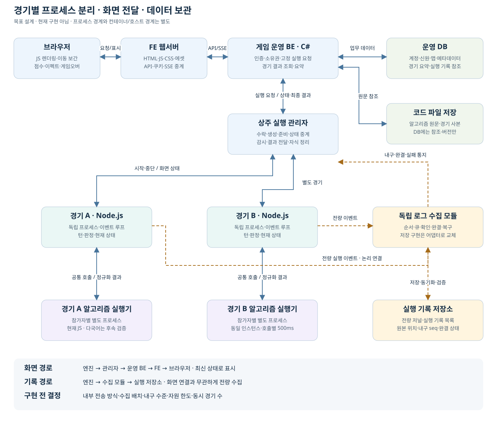
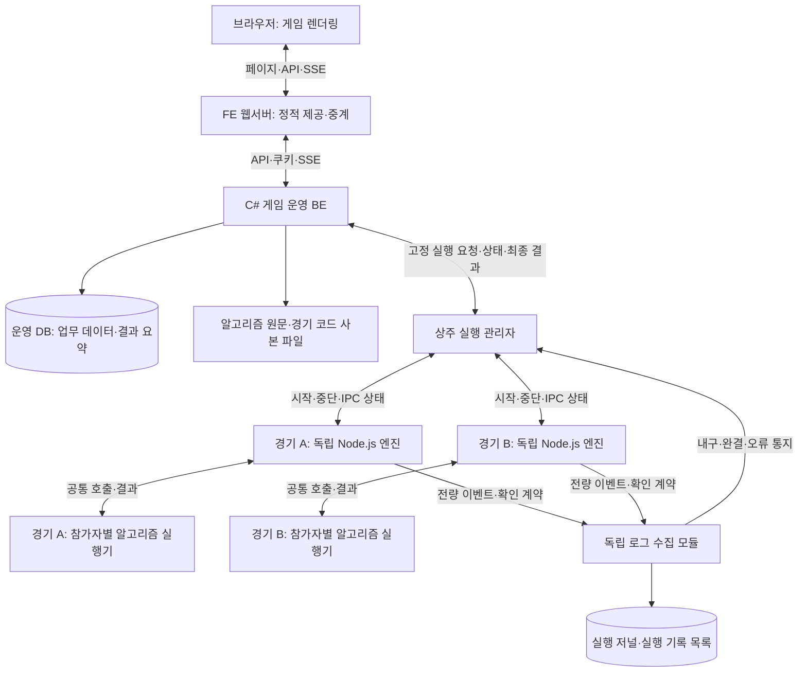
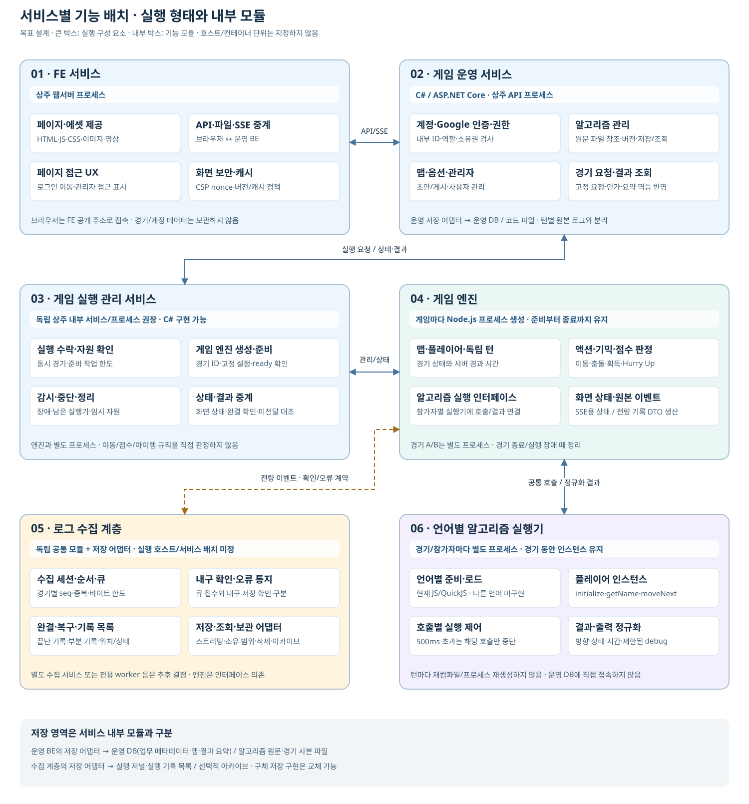
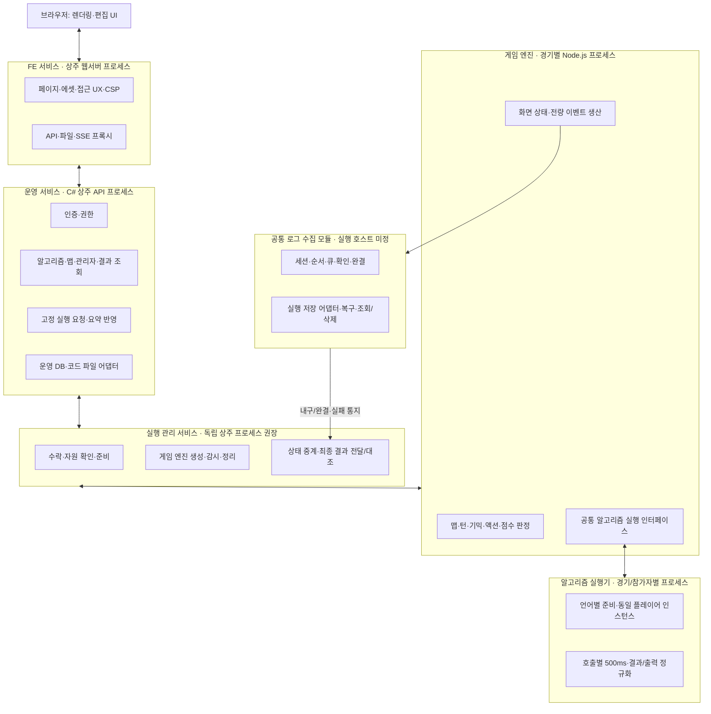
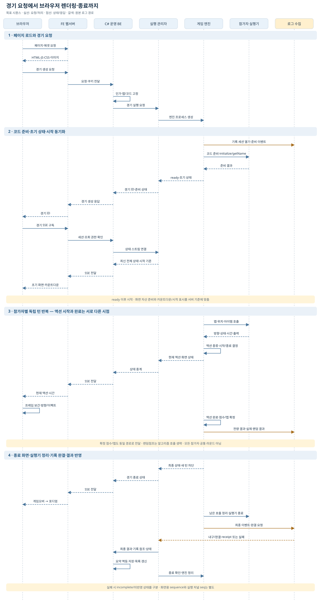
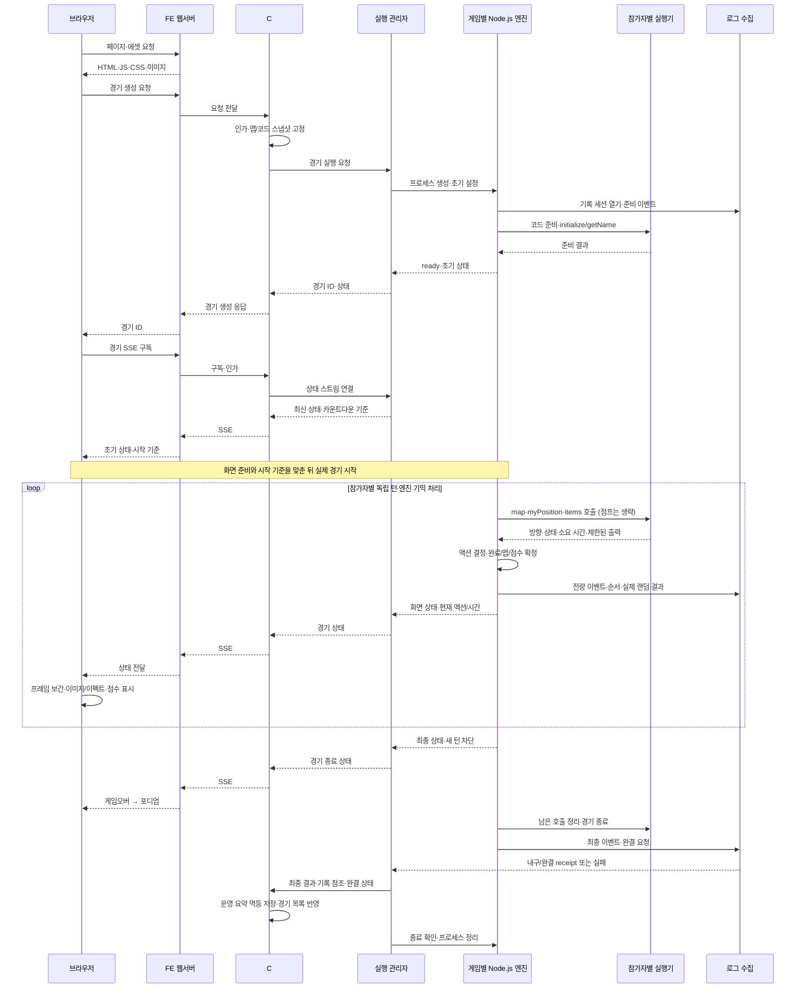

# 게임별 엔진 분리와 브라우저 렌더링 전체 흐름

- 작성일: 2026-11-15
- 성격: 이번 논의에서 정리한 목표 구조와 실행 흐름. 현재 동작하는 배포 구조를 의미하지 않는다.
- 현재 구현: 통합 Node.js 서버 안에 경기별 Match 인스턴스가 있고 참가자별 알고리즘 프로세스만 분리되어 있다. C# 운영 BE·실행 관리자·게임별 엔진 프로세스·전량 로그 수집은 아직 구현 전이다.
- 열람: [차트 포함 HTML](game-execution-rendering-flow.html), [전체 구성도 SVG](diagrams/game-execution-architecture.svg), [서비스별 기능 배치 SVG](diagrams/game-service-functional-layout.svg), [시간순 흐름 SVG](diagrams/game-execution-sequence.svg).
- 관련: [FE 요구사항](frontend-deployment-requirements.md), [운영·실행 책임](game-backend-boundaries.md), [로그 수집 계약](game-log-collection-modules.md), [운영 DB 계획](game-operations-database-plan.md).
- 실행 계약/작업 순서: [실행기 추상화·독립 실행·호출 비용 최적화](algorithm-runner-independence-plan.md). 차트의 참가자별 프로세스는 기존 격리안이며 직접 호스팅/IPC의 최종 선택은 이 계획의 검증과 함께 정한다. 실제 계산 성능을 없애는 시간 보정은 적용하지 않는다.

## 1. 전체 구성과 책임

게임 운영은 C#/ASP.NET Core, 게임 엔진은 기존 Node.js를 유지하는 방향을 기준으로 설명한다. 상주 실행 관리자는 운영 BE와 독립된 내부 서비스/프로세스로 두는 것을 권장하며 경기마다 엔진 프로세스를 생성하고 감시한다. 관리자는 C#으로 구현할 수 있다. 이 문서는 기능의 실행 형태와 내부 배치를 구분하고 호스트/컨테이너 등 실제 배포 단위를 지정하지 않는다.

| 영역            | 수행할 일                                                       | 소유하지 않는 책임                |
| --------------- | --------------------------------------------------------------- | --------------------------------- |
| 브라우저        | 초기 맵 구성, 상태 적용, 이동 보간·캐릭터/이펙트·점수/결과 표시 | 알고리즘 실행, 점수/충돌 판정     |
| FE 웹서버       | 화면/에셋 제공, 페이지 접근 UX, API·쿠키·SSE 중계               | 경기 상태·원문·계정 DB 보관       |
| 운영 BE         | 인증/인가·맵/코드 선택·고정 실행 요청·조회 권한·경기 요약       | 매 턴 판정과 원본 로그 저장       |
| 실행 관리자     | 동시 실행 수/자원 수락·게임 엔진 생성/준비·감시/정리·상태 중계  | 코인/벽/아이템 규칙 재판정        |
| 게임 엔진       | 해당 경기의 상태·독립 턴·기믹·실제 결과 확정·이벤트 생산        | 사용자 계정 관리·로그 저장소 구현 |
| 알고리즘 실행기 | 준비된 참가자 인스턴스의 초기화/호출·제한/오류/출력 정규화      | 게임 점수·완결 상태 결정          |
| 로그 수집       | 순서·중복·크기 제한 큐·내구 확인·완결/복구·조회/보관            | 화면 연결에 따른 기록 생략        |

차트의 수집 연결은 논리 인터페이스다. 직접 IPC/네트워크 또는 관리자 경유 중계 중 무엇을 쓰든 이벤트 ID·순서·수락/내구 확인 의미를 보존한다. 수집기를 모든 게임 엔진 안에 파일 writer로 내장해야 한다는 의미가 아니다.

### 1.1 서비스별 기능 배치

**게임 실행 관리 서비스가 게임마다 새 Node.js 프로세스를 생성한다는 의미다.** 게임 시작 준비 시 같은 게임 엔진 프로그램을 별도 프로세스에 로드하고 각 프로세스는 해당 게임의 맵·턴·점수·타이머 상태만 유지한다. 새 프로그램을 매번 작성/빌드하는 것이 아니라 같은 프로그램의 독립 실행 인스턴스를 만드는 것이다.

관리 서비스는 계속 상주한다. 게임 엔진 프로세스는 준비부터 해당 게임 종료까지 유지하고 정상 종료에서는 알고리즘 정리·기록 완결 확인 뒤 종료한다. 실행 실패/종료 기한 초과는 명시적 실패/미완결 처리 후 정리한다. 매 턴 또는 500ms 시간 초과마다 게임 엔진/알고리즘 프로세스를 새로 띄우지 않는다. 이 설명은 목표 구조이며 현재 통합 서버에 이미 적용한 동작은 아니다.

아래 차트의 큰 박스는 서비스/실행 구성 요소, 내부 박스는 해당 구성 요소 안의 기능 모듈이다. 모든 큰 박스가 별도 물리 서버·컨테이너라는 의미는 아니다. 실행 관리자는 게임 엔진을 포함해 같은 프로세스에서 경기 규칙을 처리하지 않고 게임별 엔진 프로세스를 관리한다.

| 구성 요소             | 실행 형태·수명                                                         | 내부 기능                                                               | 연결 대상                                                  |
| --------------------- | ---------------------------------------------------------------------- | ----------------------------------------------------------------------- | ---------------------------------------------------------- |
| 브라우저 클라이언트   | 사용자 브라우저에서 실행, 페이지 수명                                  | 게임 렌더러·애니메이션·작업실/관리자 UI·SSE 수신                        | FE 공개 주소                                               |
| FE 서비스             | 상주 웹서버 프로세스                                                   | 페이지/에셋 제공·API/파일/SSE 중계·접근 UX·CSP                          | 브라우저, 운영 BE                                          |
| 게임 운영 서비스      | C#/ASP.NET Core 상주 API 프로세스                                      | 계정/인증/인가·알고리즘/맵/관리자·고정 실행 요청·결과 조회·저장 어댑터  | FE, 실행 관리 서비스, 운영 DB/원문 파일                    |
| 게임 실행 관리 서비스 | 운영 BE와 독립된 상주 내부 서비스/프로세스 권장, C# 구현 가능          | 수락/자원 확인·준비/생성·감시/정리·상태 중계·결과 전달/대조             | 운영 BE, 게임 엔진 프로세스, 수집 상태                     |
| 게임 엔진             | 게임마다 별도 Node.js 프로세스                                         | 초기 상태·독립 턴·액션/기믹/점수 판정·화면 상태/원본 이벤트 생산        | 실행 관리자, 참가자별 실행기, 수집 인터페이스              |
| 알고리즘 실행기       | 경기/참가자마다 별도 프로세스, 경기 동안 인스턴스 유지                 | 언어별 준비/로드·initialize/getName/moveNext·500ms 제어·출력 정규화     | 해당 게임 엔진. 운영 DB에 직접 접속하지 않음               |
| 로그 수집 계층        | 독립 수집 모듈과 저장 어댑터. 구체 실행 호스트/별도 서비스 여부는 미정 | 수집 세션·순서/큐·내구 확인·완결/복구·기록 목록·조회/삭제·아카이브 연결 | 엔진의 수집 인터페이스, 관리자 확인/오류 경로, 실행 저장소 |
| 저장 계층             | 저장 인터페이스 뒤의 DB/파일 구현, 서비스 실행 코드와 구분             | 운영 업무 데이터·알고리즘 원문 파일·별도 실행 저널                      | 운영 저장 어댑터와 실행 저장 어댑터를 각각 사용            |

로그 수집은 아직 독립 서버로 확정하지 않았으므로 차트에도 **공통 수집 모듈/어댑터·실행 호스트 미정**으로 표시한다. 별도 상주 수집 서비스 또는 신뢰된 실행 호스트 내부의 전용 worker 등 어떤 형태를 채택하더라도 엔진의 공개 수집 인터페이스와 내구/오류 계약을 유지한다.

서비스 박스 내부의 세부 처리 순서는 이후 시퀀스 차트를 따른다. 이 차트는 기능 배치가 목적이며 모듈마다 별도 네트워크 서비스나 DB를 만든다는 의미가 아니다.

## 2. 경기 요청에서 화면 표시까지

### 2.1 페이지와 경기 준비

1. 브라우저가 FE에서 HTML·JS·CSS·에디터/캐릭터/코인/아이템/영상 자산을 받는다. 공개 서비스 주소는 하나이고 `/api/*`는 내부 운영 BE로 전달한다.
2. 사용자가 코드·맵·시작 위치·허용된 옵션을 선택해 경기 생성을 요청한다. 운영 BE가 게스트/계정·소유권·맵 게시 상태·참가 범위를 확인한다.
3. 경기 ID, 맵/옵션 스냅샷, 참가자별 코드/언어/해시/보관 참조를 고정한다. 원본을 이후 수정해도 해당 경기 요청은 바뀌지 않는다. 코드 내용은 계속 파일로 보관하고 실행 영역에는 읽기에 필요한 참조/사본만 제공한다.
4. 실행 관리자가 허용 동시 경기/준비 자원을 확인하고 Node.js 엔진 프로세스를 생성한다. 필요한 실행 기록 세션을 준비 단계부터 연다. 빌드/초기화 실패도 기록 범위에 들어간다.
5. 엔진이 참가자별 실행기를 준비하고 initialize/getName을 수행한다. 향후 컴파일 언어의 빌드/준비는 경기 시작 전에 수행하고 매 턴 원문을 재로드하거나 프로세스를 재생성하지 않는다.
6. 준비 완료 이후 초기 전체 상태와 경기 시작 기준을 전달한다. 운영 BE가 반환한 경기 ID로 SSE를 구독하며 생성 응답과 구독 사이의 이벤트는 최신 초기 상태/현재 단계 전달로 보완한다. ready 이전에는 실제 경기 시간을 시작하지 않는다.
7. 브라우저는 에셋/초기 상태 준비를 마친 뒤 카운트다운과 시작 표시를 서버 시작 기준에 맞춘다. 현재의 시작 표시 유지 시간을 포함해 실제 시작 시점을 엔진과 일치시킨다. 에셋 준비 확인/시작 승인 세부 메시지는 구현 시 확정한다.

### 2.2 독립 턴과 엔진 판정

사용자 확정 기준: 계산 결과가 준비되는 즉시 해당 플레이어의 액션을 시작하고 액션이 끝나면 다음 계산을 요청한다. 실제 계산 속도가 경기 진행 속도와 승부에 반영되어야 한다. 모든 플레이어의 결과를 기다리는 공통 라운드·고정 판단 지연·계산 시간을 제거하는 논리 시간 스케줄러는 적용하지 않는다. 호출 인프라의 언어별 손해는 실행기 경로의 최적화와 검증 대상으로 다룬다.

1. 엔진이 참가자의 호출 시점 맵·자기 위치·아이템 배열을 알고리즘 실행기에 전달한다. 참가자별 턴은 독립적으로 진행한다.
2. 실행기가 정규화된 방향·상태·알고리즘 소요 시간·제한된 debug 출력/생략 수를 반환한다. 500ms는 해당 알고리즘 호출에 적용하고 저장/중계 대기를 포함하지 않는다.
3. 엔진이 이동/충돌/제자리/망치/점프 등 실제 액션과 출발·목표·시작/종료 경과 시간을 결정한다. 랜덤점프 효과 중에는 알고리즘 호출 없이 엔진이 실제 목적지를 결정하고 호출 생략을 기록한다.
4. 브라우저는 액션 정보를 받아 애니메이션을 수행한다. 엔진은 서버 시계로 액션 완료를 판정하고 위치·획득·점수·효과·맵 변화를 확정한다.
5. 턴 밖 아이템 생성·Hurry Up·코인 소멸·벽 변화 등도 엔진이 판정한다. 알고리즘 결과만으로 실제 결과나 맵을 추측하지 않는다.

각 경기의 이벤트 루프/메모리를 프로세스로 분리하지만 CPU·메모리·디스크·네트워크는 같은 호스트에서 경합할 수 있다. 엔진 1개와 참가자별 실행기(4인 경기면 4개)에 관리/수집 프로세스가 더해지므로 동시 경기 수와 자원 한도를 실제 부하로 결정한다.

### 2.3 화면 전달과 렌더링

화면 상태는 **엔진 → 실행 관리자 → 운영 BE → FE → 브라우저**로 전달한다. 브라우저까지는 기존 SSE 의미를 유지하고, 내부 프로토콜은 별도 계약으로 정의한다. 중간 계층이 게임 규칙을 다시 실행하지 않는다. 전체 경기를 포트 하나씩 외부에 노출하지 않으며 조회/구독 인가는 운영 BE에서 한다.

| 화면 데이터                                           | 목적                                                                  |
| ----------------------------------------------------- | --------------------------------------------------------------------- |
| 경기 ID·화면 상태 순번·서버 경과 시간·단계            | 다른 경기/오래된 상태 구분, 시간 보정, 준비/카운트다운/진행/종료 표시 |
| 초기 전체 맵/옵션·참가자·위치                         | 첫 화면과 재연결 복원                                                 |
| 플레이어 위치/방향·액션 출발/목표·시작/종료 시간·효과 | 이동/제자리/망치/점프·방향별 이미지·잔상/아이콘 표시                  |
| 확정 점수·순위·코인/아이템/벽 변화                    | 실제 획득과 UI 반영                                                   |
| 최종 결과·종료 사유                                   | 게임오버·포디엄·결과 분석                                             |

서버는 영상 프레임을 보내지 않는다. 예를 들어 이동 액션이 400ms라면 브라우저는 출발/목표·시간을 이용해 각 화면 프레임의 위치를 보간한다. 신발은 서버가 정한 짧아진 액션 시간을 그대로 따른다. 점수·충돌·랜덤 결과는 서버 상태로 확정하며 프런트엔드가 별도로 결정하지 않는다. 지연 수신은 서버 경과 시간 추정과 최신 상태로 보정하고 타이머 시작을 메시지 수신 시각으로 무조건 재설정하지 않는다.

전체 snapshot 또는 변경분+주기적 snapshot의 최종 전송 방식/주기는 부하 검증 후 결정한다. 변경분을 쓰면 기준 버전과 누락 시 전체 재조회가 필요하다. 화면 중계는 제한된 버퍼로 최신 상태를 유지하며 이전 상태를 생략하더라도 현재 액션/맵/점수가 복원되게 한다. 손실 불가 명령/준비/종료 결과를 화면 snapshot과 같은 폐기 정책으로 처리하지 않는다.

### 2.4 종료와 결과 반영

1. 엔진이 마지막 결과를 확정하고 새 턴을 막는다. 남은 액션/호출을 완료·취소·늦은 응답 미적용으로 정리한다.
2. 최종 상태를 브라우저에 전달해 기존 게임오버 표시(약 3초) 후 포디엄을 보여 준다. 이 UI 표시가 로그 완결이나 운영 DB 반영 성공을 뜻하지는 않는다.
3. 참가자별 실행기를 종료하고 모든 원본 이벤트를 수집기로 전달한다. 정상 경로는 수집기의 drain·내구 확인·완결 receipt를 확인한다.
4. 실행 관리자는 최종 결과·기록 참조·완결 상태를 운영 BE로 멱등 전달한다. 미전달 결과는 재시도/재기동 대조가 가능하게 보관한다. 운영 BE는 요약을 저장하고 사용자 경기 목록 갱신에 반영한다.
5. 정상 종료 확인 후 엔진 프로세스를 정리한다. 종료 기한 초과/저장 실패는 별도 실패/미완결 상태로 처리하며 엔진 프로세스를 무기한 유지하지 않는다.

## 3. 시간순 시퀀스 차트

이 차트는 논리 순서다. 액션 시작 전달과 실제 완료는 시간상 분리되며 점수는 완료 확정 후 반영한다. 내부 메시지 이름/전송 방식은 구현 전 확정한다. 수집 완결 응답이 관리자에게 전달되는 구체 경로는 직접 응답 또는 엔진 중계로 구성할 수 있다.

## 4. 화면 스트림과 원본 기록의 차이

| 구분          | 화면용 스트림                               | 실행 원본 저널                                        |
| ------------- | ------------------------------------------- | ----------------------------------------------------- |
| 목적          | 현재 화면을 지연 적게 표시                  | 모든 실행 사실의 보관·진단·복원 근거                  |
| 순번          | 화면 상태 전용 sequence                     | 경기 전역 journal seq·플레이어 turnId·호출 ID         |
| 느린 수신     | 최신 상태로 병합하거나 연결을 닫고 재동기화 | 조용한 샘플링/드롭 금지, 제한된 큐와 명시적 장애 정책 |
| 브라우저 단절 | 경기 자체는 계속, 재구독 시 최신 전체 상태  | 수집 계속. 브라우저/SSE를 원본으로 삼지 않음          |
| 저장          | 브라우저 메모리의 표시 상태                 | 독립 수집/저장 어댑터·내구/완결 확인                  |

초기 상태와 모든 확정 변화/실제 랜덤 결과를 기록하면 알고리즘을 재실행하지 않고 상태 재생을 설계할 수 있다. 리플레이 UI는 이번 문서화 범위가 아니다. 큐 수락과 내구 저장 확인은 다르고 정상 종료 전량 보존과 전원/호스트 장애까지의 보장은 [수집 계약](game-log-collection-modules.md)에서 별도 결정한다.

## 5. 재연결·장애·미구현 범위

- 브라우저/FE 연결 단절: 운영 BE에서 권한을 재확인하고 경기 ID의 최신 전체 상태로 복원한다. 재구독만으로 새 경기/실행기를 만들지 않는다. 과거 모든 액션의 화면 재생을 보장하는 재연결은 별도 요구다.
- FE 재시작: BE의 경기와 세션은 유지되는 구조를 목표로 하되 자동 재구독·페이지 복귀 시나리오를 검증한다.
- 게임 엔진 비정상 종료: 관리자가 해당 경기 실패를 판정하고 남은 참가자 프로세스/연결/임시 파일을 정리한다. 진행 중 경기를 조용히 처음부터 재실행하지 않는다. 수집기는 마지막 확인 구간과 incomplete 상태를 남긴다.
- 운영 BE/관리자 재시작: 경기·소유권 매핑·자식 프로세스 생존/재연결·미반영 결과 대조 정책을 구현해야 한다. 프로세스 분리만으로 경기/세션의 무손실 재개가 보장되지 않는다.
- 알고리즘 500ms 초과: 이번 호출만 중단하고 해당 턴 패널티. 경기/알고리즘 프로세스는 종료하지 않는다. 프로세스 정리는 경기 종료/실행 장애 때 수행한다.
- 다국어: 현재 JavaScript/QuickJS만 구현되어 있다. C#/C++/Python은 사전 준비·중단·동일 인스턴스 유지 검증 뒤 공통 실행 어댑터로 연결한다.
- 배포: FE/BE/관리/경기/수집의 프로세스 경계와 컨테이너/호스트 배치를 구분한다. 실제 주소·TLS·VPN·DB 제품/위치·동시 실행 수와 메모리/CPU/종료 한도는 아직 확정하지 않았다.

기존 2026-10-17 전체 구조와 2026-11-15 초기 FE 요구사항 중 통합 BE를 전제로 한 부분은 이번 목표 흐름과 대조해 구현 계획을 갱신한다. 이번 산출물은 설명·차트 보관이며 닷넷 BE 포팅·경기 프로세스 분리·로그 구현을 실행한 것은 아니다.
