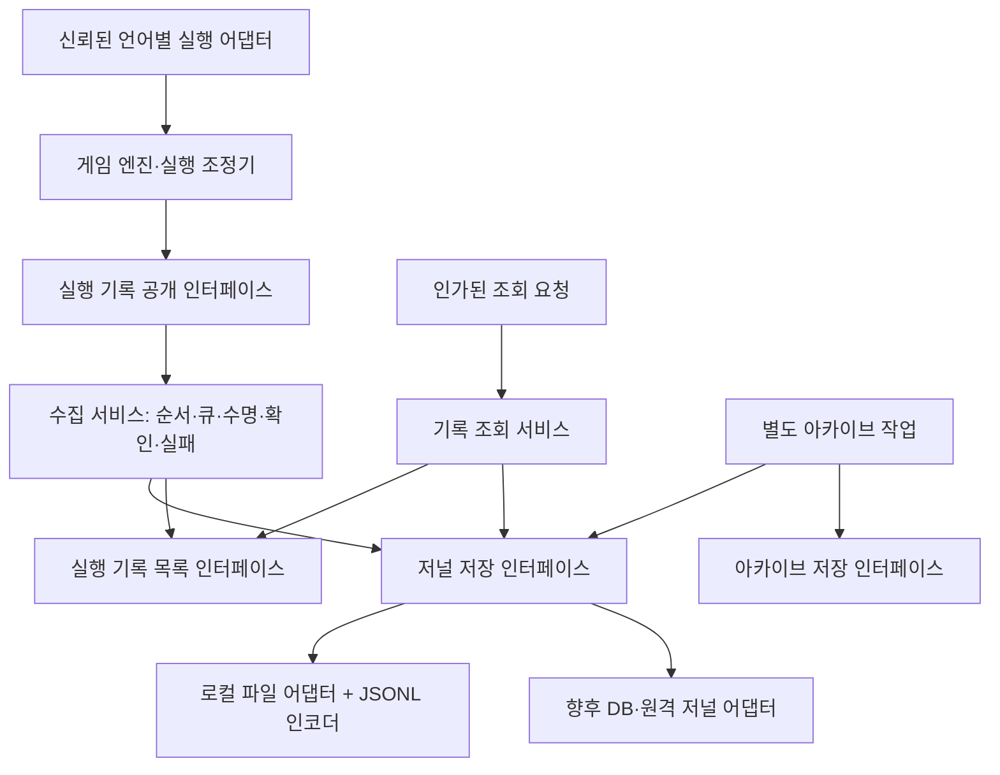

# 게임 실행 로그 수집의 모듈·추상화 계약

- 작성일: 2026-11-15
- 상태: 설계 기준. 실제 수집 모듈·저장 어댑터·서비스 분리는 아직 구현하지 않았다.
- 요구: 게임 로그 수집을 독립된 기능으로 구성하고, 저장·전송 구현을 교체할 수 있도록 모듈화한다.
- 기준: [백엔드 책임 경계](game-backend-boundaries.md), [전량 로그 저장 분석](game-log-storage-analysis.md).

## 1. 의존 방향

게임 운영 BE, 게임 엔진, 로그 수집기는 각자 책임과 공개 계약을 갖는다. 수집기는 게임 실행 영역의 독립 모듈이며 별도 프로세스 배치도 가능하다. 별도 모듈이 곧 별도 네트워크 서버를 뜻하지는 않는다.



엔진에서 파일 경로·DB 드라이버·Blob SDK·Pino·worker API를 직접 호출하지 않는다. 기동 시 구성부에서 정책과 어댑터를 조합해 공개 인터페이스를 주입한다. 실제 저장소와 자격 증명을 아는 코드는 이 구성부와 인프라 어댑터다.

## 2. 모듈별 책임

| 모듈/계약                 | 담당                                                                      | 담당하지 않는 것                    |
| ------------------------- | ------------------------------------------------------------------------- | ----------------------------------- |
| 실행 이벤트 계약          | 이벤트 버전·종류·식별자·필드·크기·호환 규칙                               | JSONL 줄바꿈·DB 컬렉션·게임 판정    |
| 엔진/실행 어댑터          | 알고리즘 결과와 실제 엔진 판정에서 검증된 이벤트 DTO 생산                 | 저장·압축·재시도·보관               |
| 실행 기록 공개 인터페이스 | 경기 기록 시작·이벤트 제출·기록 상태·내구 확인·종료                       | 구체 저장 장치/API                  |
| 수집 서비스               | 경기별 직렬화·seq·중복 검사·바이트 제한 큐·확인·종료·오류 통지            | 코인 점수 판정·계정 DB 갱신         |
| 저널 저장 어댑터          | 순서 있는 배치 저장·내구 확인·완결·스트리밍 읽기·부분 기록 검사/복구·삭제 | 경기 중단 여부·사용자 인가          |
| 실행 기록 목록 저장소     | 위치 참조·소유/참가 범위·완결 상태·seq·크기·보관 기한·미전달 결과         | 전체 이벤트를 운영 계정 문서에 누적 |
| 조회/보관 서비스          | 권한 범위에 따른 스트리밍·보관 만료·삭제·아카이브 조정                    | 원문 코드의 자동 영구 보관          |
| 아카이브 저장 어댑터      | 완결 기록의 업로드/검증/재시도·읽기·삭제                                  | 진행 중 경기의 내구 저장 대체       |

JSONL 인코더는 파일 어댑터의 세부 구현이다. 다른 저장소는 같은 이벤트를 문서/청크로 저장할 수 있다. 이벤트 스키마를 파일 표현에 맞춰 바꾸지 않는다. 큐·확인·종료 정책은 수집 서비스, 구체 저장 오류와 실제 동기화는 어댑터가 담당한다. 처음부터 모든 보조 함수를 개별 플러그인으로 만들지는 않는다.

## 3. 공개 인터페이스의 의미

아래 이름은 설계 예시이며 최종 API나 구현 완료를 뜻하지 않는다.

```text
ExecutionRecorder.open(context) -> RecordingSession
session.submit(eventBatch) -> accepted { firstSeq, lastSeq }
session.waitDurable(seq) -> { durableThroughSeq }
session.finish(summary) -> receipt
session.status() -> recordingStatus

JournalStore.open(context, requirements) -> JournalSession
journal.append(orderedBatch) -> appendReceipt
journal.syncThrough(seq) -> durableReceipt
journal.seal(finalSeq, summary) -> sealedReceipt
journal.closeIncomplete(reason) -> recoveryReference
JournalStore.read(reference, range) -> async stream
JournalStore.recover(reference) -> recoveryReport
JournalStore.delete(reference) -> deletionReceipt
```

- `submit`의 accepted는 제한된 큐가 이벤트 사본을 수락했다는 의미다. 디스크 저장이나 장애 시 보존을 뜻하지 않는다. 배치는 전부 수락하거나 전부 거부하고 수락 전에 용량을 확보한다. 포화 시 무한 대기열/Promise를 추가하지 않고 명시적 포화 결과를 돌려준다. 호출 측이 원본 배치를 유지해 재시도하거나 기록 실패로 전환한다.
- 제출은 경기별 단일 조정 경로를 통과한다. 불변 DTO를 수락하는 순서대로 seq를 부여하고 모든 플레이어/기믹의 확정 순서를 유지한다. 별도 저장 작업 완료 순서로 seq를 만들지 않는다. 전송 재시도용 eventId는 수락 전에 고정하고 같은 ID/다른 내용은 오류다.
- `append` 수락/쓰기 완료와 `syncThrough` 내구 확인은 다르다. 내구 seq는 중간 누락 없이 연속된 접두 구간만 가리킨다. 손실 가능 버퍼를 둔 worker/네트워크 전송 완료를 durable로 표시하지 않는다.
- `finish`는 새 제출을 닫고 확정된 최종 이벤트까지 drain·내구 확인·완결 처리한 뒤 receipt를 반환한다. 기록 미완결이면 정상 sealed receipt를 반환하지 않는다. 완료 재호출과 재시도는 같은 기록/최종 seq를 반환하며 요약 불일치는 거부한다.
- 마지막 이벤트는 자신까지 포함한 파일 해시를 담지 않는다. 최종 seq·크기·해시·위치·보관 상태는 기록을 닫은 후 receipt/manifest에 확정한다. 파일과 목록 저장소 사이의 실패는 복구/대조 대상으로 남긴다.
- 실제 파일 경로 대신 불투명한 기록 참조를 사용한다. `read`는 이벤트 단위 스트리밍을 제공하며 범위 읽기는 어댑터에 따라 순차 탐색일 수 있다. 전체 기록의 메모리 로드를 강제하지 않는다.

## 4. 교체 가능한 구현과 유지해야 할 보장

1차 후보는 현재 Node 실행 환경에서 전용 writer worker와 영구 볼륨의 JSONL 저장이다. 인터페이스는 Node 모듈이나 특정 SDK에 종속시키지 않는다. 향후 NoSQL 이벤트 저장·원격 수집으로 교체해도 엔진 이벤트 생산 코드는 유지한다. 실제 배포를 바꾸면 설정·접속·복구·성능 검증은 필요하다.

각 어댑터는 지원하는 내구 확인 범위, 배치/레코드 상한, 중복 처리, 복구/읽기/삭제 지원을 명시한다. 기동 시 필요한 보장과 대조하고 충족하지 못하면 구성을 거부한다. JSONL 어댑터가 제공하던 내구 확인을 새 어댑터가 메모리 수락으로 조용히 대체하는 구성은 허용하지 않는다. 제품의 실제 보장을 넘어선 공통 보장은 약속하지 않는다.

경기별 writer는 하나다. 파일은 단일 작성자와 기존 기록 검사로, DB/원격 어댑터는 저장소에 맞는 고유 키·조건부 쓰기·작성 권한 제어로 순서/중복을 보장한다. 향후 다중 수집 프로세스에서 동일 경기를 받는다면 작성자 교체와 이전 작성자 차단까지 구현한 뒤 허용한다. 수집기 재시작만으로 자동 무손실 재개가 된다고 가정하지 않는다.

실행 기록 목록과 게임 운영의 경기 목록은 별개다. 전자는 저장 원본의 위치/완결과 복구에 필요하고, 후자는 사용자에게 보여 줄 결과 요약이다. 운영 DB 제품을 바꾸더라도 저널 어댑터를 바꿀 필요가 없어야 한다. 아카이브는 완결 후 독립 작업이며 실패하면 원본을 유지하고 검증된 사본의 위치를 갱신한다.

## 5. 언어·프로세스 경계

엔진이 사용하는 이벤트 DTO와 전송 규약을 분리한다. 현재는 프로세스 내 주입 또는 worker IPC 어댑터를 사용할 수 있고 향후 실행 호스트와 수집기 사이의 IPC/네트워크 어댑터를 둘 수 있다. 전송 수단을 바꿔도 이벤트 의미·eventId·경기 seq·확인 의미는 유지한다.

C#/C++/Python/JavaScript 실행기는 결과를 신뢰된 호스트 어댑터로 돌려주고 실행 조정기가 게임 이벤트와 합쳐 제출한다. 사용자 코드 stdout을 수집 명령으로 해석하거나 사용자 코드가 seq/점수/완결을 결정하게 하지 않는다. 진단은 기존 크기 제한과 생략 수를 포함하고 live guest 객체를 직렬화하지 않는다.

500ms는 알고리즘 호출 제한이다. 큐 대기·저장 지연을 알고리즘 실행 시간에 합산해 사용자 코드의 패널티로 처리하지 않는다. 다른 언어의 컴파일·중단·인스턴스 유지 구현은 기존 보류 범위이며 로그 추상화를 만든 것만으로 해결되지 않는다.

## 6. 실패·종료 정책

수집 서비스는 포화·쓰기 실패·내구 확인 실패를 명시적으로 실행 조정기에 통지한다. 수집기가 게임 상태를 임의 수정하거나 오류를 삼켜 정상 진행하지 않는다. 경기별/전체 큐·최대 이벤트 크기·활성 기록 수를 제한하고, 어댑터 내부 버퍼와 전송 계층에도 같은 메모리 제한을 적용한다.

동기 제출 거부뿐 아니라 수락 이후 발생한 비동기 writer 실패도 세션의 오류 통지 경로로 전달한다. 해당 세션의 대기 중인 내구 확인/완결 요청을 실패시키고 상태를 갱신한다. `status` 폴링이나 일반 서버 로그 출력만으로 경기 조정기에 실패를 전달한 것으로 처리하지 않는다.

저장 장애 시 새 경기 수락 제한, 새 턴 요청 중단과 제한된 복구 대기, 기록 실패 종료 중 어떤 정책을 쓸지는 실행 조정 정책에 둔다. 비동기 경기에서 대기할 경우 진행 중 액션·기믹·시계·응답을 어떻게 정리하는지 함께 정해야 하며 특정 플레이어만 저장 대기로 늦추지 않는다. 무한 재시도나 조용한 레코드 폐기는 사용하지 않는다.

내구성 수준은 구현 전 확정할 별도 정책이다. 정상 종료 시 전량 보존하는 비동기 기록과 호스트 장애에도 이미 외부 확정한 결과를 보존하는 방식은 다르다. 후자는 상태 변경의 준비/내구 확인/확정 흐름까지 엔진과 조율해야 하며 `submit` 호출 추가만으로 달성되지 않는다.

종료는 새 턴 차단 → 진행 중 턴/늦은 응답을 완료·취소·미적용으로 정리 → 실행기 종료 → 최종 이벤트 → drain/내구 확인/완결 → 결과 참조 전달 순서다. 종료 기한 초과·저장 실패는 incomplete로 남기고 재시작 시 검사한다. 저장소 자체가 고장 난 경우 실패 사실을 그 저장소에 반드시 쓸 수 있다고 보장하지 않는다.

## 7. 조회·삭제·운영 연결

운영 BE는 사용자 권한을 확인한 조회 범위를 실행 조회 서비스에 전달한다. 소유/참가 범위와 비공개 debug 조회를 구분하고 내부 파일 경로나 공개 저장 URL로 우회하지 않게 한다. 저장 어댑터가 운영 계정 DB를 직접 조회하게 만들지 않는다.

수집 context에는 소유/참가 범위와 보관 분류를 연결하되 매 턴 이메일/OAuth 신원·인증 정보·코드 원문을 반복하지 않는다. 개인정보 운영 준비에서 보관 기간을 정할 수 있도록 처음부터 소유자별 열거·삭제 요청과 진행 중 쓰기 차단·로컬/아카이브 삭제 추적을 연결한다. 구체 보관 기간과 게스트/테스트의 열람·삭제 방식은 아직 확정하지 않는다.

## 8. 구현 순서와 검증

1. 이벤트 스키마·경기/턴 ID·실제 확정 지점과 취소/늦은 응답을 정의한다. 내구성/장애 정책과 게스트/테스트 수집 범위를 확정한다.
2. 공개 수집 인터페이스·수집 서비스·제한된 메모리 가짜 어댑터를 만들어 순서/중복·용량·실패·종료 계약을 검증한다. 가짜 저장소는 테스트 전용이며 운영 fallback으로 사용하지 않는다.
3. 로컬 JSONL/worker 어댑터·실행 기록 목록·부분 파일 복구·스트리밍 읽기·삭제를 구현하고 공통 계약 테스트를 적용한다.
4. 엔진/실행 조정기에 주입해 모든 결과·액션·기믹을 연결한다. 알고리즘 시간 제한·플레이어 독립 실행·완료/취소 수와 최종 상태가 유지되는지 확인한다.
5. 운영 결과 요약과 상세 기록 참조를 멱등 연결하고 권한·보관/삭제 연결을 구현한다. 중간 장애 후 미반영 결과와 파일/목록 불일치를 복구한다.
6. 동시 경기·느린 저장소·disk full·worker 종료·중복 제출·강제 종료·부분 줄로 검증한다. 큐 bytes·내구 seq 지연·게임 루프 지연·기록 크기를 측정한다.

새 저장 어댑터는 같은 계약 테스트를 통과해야 한다. 이벤트 재적용으로 엔진 상태가 일치하는지 검증하되 알고리즘 재실행으로 대체하지 않는다. 실제 DB/Blob 어댑터 추가와 물리 서비스 분리는 선택한 배포 구조에 따라 후속 구현한다.
